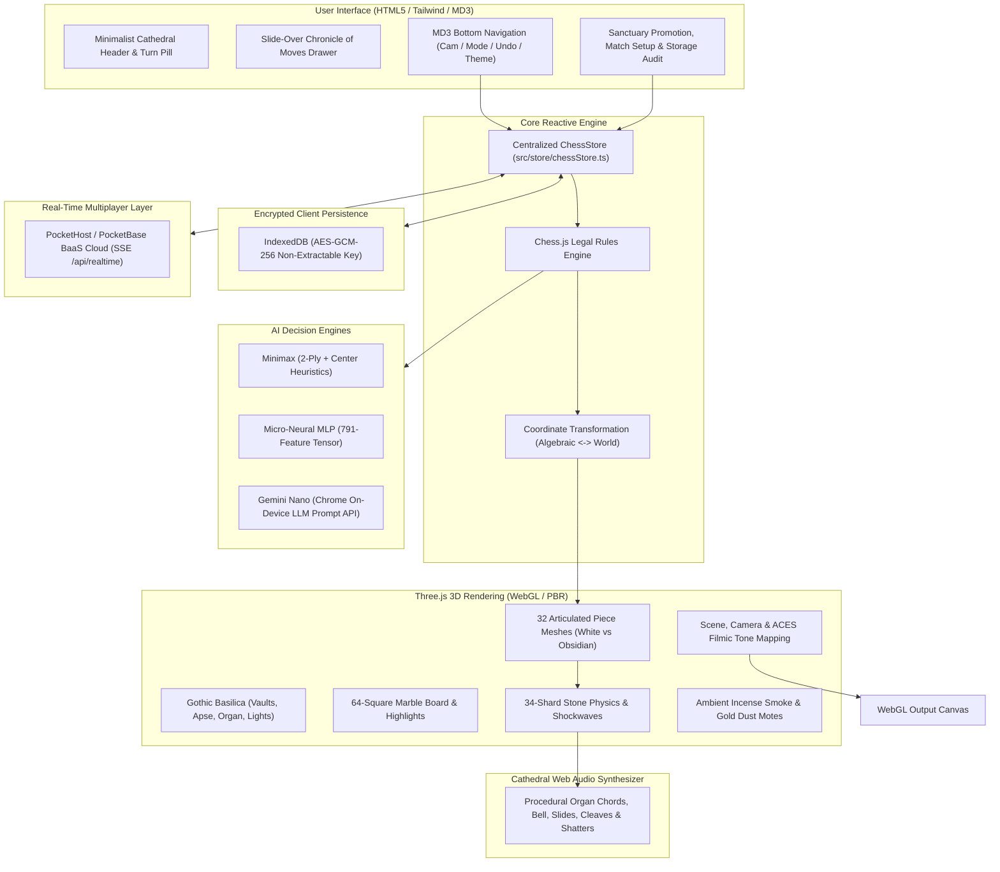

# ♟️ Wizard's Chess 3D & Sanctuary Arcade Hub — High Gothic Basilica

[](package.json)
[](https://www.typescriptlang.org/)
[](https://bun.sh/)
[](https://vitejs.dev/)
[](https://threejs.org/)
[](https://pockethost.io)
[](docs/SECURITY_PERSISTENCE.md)
[](docs/DATETIME_TEMPORAL.md)
[](coverage/coverage-report.md)
[](https://web-chess-app.netlify.app)
[](https://opensource.org/licenses/MIT)

An immersive, fully articulated 3D Wizard's Chess and **8-Game Sanctuary Tabletop Arcade Hub** staged upon the Crossing Altar of a High Gothic Catholic Basilica. Designed with zero external asset dependencies, the suite features **Sanctuary Chess**, **Gothic Blackjack**, **Cathedral Poker (4 Variants)**, **Ten Rites (Phase 10)**, **Sacred Skip-Bo**, **Cardinal Uno**, **The Resistance: Avalon**, and **Sacred Geometry SET ($\text{GF}(3)^4$)**. Every game supports both intelligent AI opponents and real-time online multiplayer with dynamic AI bot hot-swapping, full-screen theater views, Hungarian-prefixed database schemas, snapshot & cold-storage history partitioning, automated 3+ day stale session pruning, and AES-GCM-256 encrypted client-side session persistence.

---

## 📚 Specialized Documentation

Detailed technical guides are available in [`docs/`](file:///Users/brentzey/personal/web-chess/docs/):

* **[🏛️ System Architecture Guide (`docs/ARCHITECTURE.md`)](docs/ARCHITECTURE.md)**: Deep dive into the client Three.js pipeline, state flow, multi-agent AI engine, and dual-stack server.
* **[🌐 Real-Time Multiplayer Guide (`docs/REALTIME_MULTIPLAYER.md`)](docs/REALTIME_MULTIPLAYER.md)**: Comprehensive guide to PocketHost Server-Sent Events, URL-first invites, schema validation rules, and monotonic sequence synchronization.
* **[🛡️ Security & Encrypted Storage Guide (`docs/SECURITY_PERSISTENCE.md`)](docs/SECURITY_PERSISTENCE.md)**: Cryptographic specifications (AES-GCM-256 Web Crypto in IndexedDB), non-extractable keys, storage audit report, and universal secret safety policy.
* **[⏱️ DateTime & ECMAScript Temporal Architecture (`docs/DATETIME_TEMPORAL.md`)](docs/DATETIME_TEMPORAL.md)**: Standardized datetime operations using ECMAScript `Temporal` API with graceful `Day.js` fallback and testing harness.

---

## 🏛️ System Architecture



---

## 🌟 Key Highlights

### 1. Real-Time 1v1 Multiplayer over PocketHost Server-Sent Events
- Connect with friends instantly across devices using **PocketHost** (`https://web-chess.pockethost.io`).
- **URL-First Sharing**: Generates a one-click invite URL (`https://web-chess-app.netlify.app/?session=SANCT-XXXX`) that automatically joins the opponent into your match without typing codes.
- **Seat Resolution & 3D Perspective**: White hosts the board facing North; Black players automatically receive a smooth 180° camera rotation framing the board from Black's perspective.
- **Full Match Synchronization**: Live moves, pawn promotions, mid-game theme synchronization, and resignations stream seamlessly over multiplexed SSE channels.
- **Tab-Refresh Reconnection**: Active match credentials and seats are securely remembered in encrypted storage, automatically re-establishing the real-time stream upon reload.

### 2. Articulated 3D Wizard Pieces
Every piece is custom-modeled in Three.js with distinctive gothic armor and weaponry:
- **Pawns**: Armored Swiss Guard Sentinels with halberds
- **Rooks**: Castellated Basilica battlement towers wielding warhammers
- **Knights**: Armored warhorse destriers equipped with jousting lances
- **Bishops**: Mitred cathedral prelates with golden crosier shepherd staffs
- **Queens**: Crowned basilica sovereigns with star scepters
- **Kings**: Cathedral-crowned monarchs wielding royal broadswords

### 3. Swappable 3D Sanctuary Themes
Switch between four high-fidelity procedural themes in real time without interrupting active matches:
- **High Gothic Basilica** (Classic Carrara White Marble & Black Obsidian)
- **Emerald Citadel** (Polished Malachite, Forest Jade & Antique Verdigris Bronze)
- **Golden Sanctuary** (Imperial Byzantine Gold, Travertine & Warm Honey Marble)
- **Obsidian Crypt** (Volcanic Basalt, Charcoal Slate & Glowing Magma Runes)

### 4. Combat Animations & 34-Shard Shatter Physics
- Pieces advance with heavy marble friction sound effects.
- Attacking pieces wind up and execute physical melee cleaves.
- Captured pieces shatter into **34 physics-driven marble or obsidian stone shards** that bounce with clinking acoustics across the Cosmati pavement.
- Expanding arcane shockwave rings and dynamic camera impact shake.

### 5. Procedural Cathedral Web Audio Engine
Synthesized in real-time via the Web Audio API with **zero external audio files**:
- D-minor pipe organ chords with bronze sanctuary bell harmonics
- Heavy stone slide friction and marble impact thuds
- Metallic cleave strikes and high-pitch shard clinks
- Celestial square selection chimes

### 6. Multi-Paradigm AI Engine & Game Modes
- Strict chess legality enforcement via `chess.js` (en passant, castling, promotion, checkmate, stalemate, threefold repetition)
- 4 distinct opponent modes: **Minimax Engine (Classical Tree Search)**, **Micro-Neural AI (Embedded Multi-Layer Perceptron)**, **Gemini Nano (Browser On-Device LLM)**, and **Pass & Play (Local 2P Duel)**
- Functional programming architecture inspired by Scala and Rust (`Option`, `Result`, compile-time exhaustive pattern matching)

### 7. Encrypted Client Storage (AES-GCM-256 Web Crypto in IndexedDB)
- **Zero LocalStorage**: All persistent state is encrypted at rest using native browser **IndexedDB** (`WizardChessSessionDB`) with Web Crypto API **AES-GCM-256** and unique 12-byte random IVs per write.
- **Storage Audit Modal**: Inspect encrypted envelopes directly to mathematically verify zero plaintext exposure at rest.
- **Two-Step Wipe & Start Over**: Instantly purge all storage and rotate the master encryption key.

### 8. ECMAScript Temporal API with Day.js Fallback
- Standardized datetime architecture in [`src/utils/dateTime.ts`](file:///Users/brentzey/personal/web-chess/src/utils/dateTime.ts).
- Automatically uses modern ECMAScript `Temporal` operations (`Temporal.Now.instant()`) when supported, with robust, monad-safe fallback to `Day.js` across legacy browsers.

### 9. 8-Game Sanctuary Tabletop Arcade Hub, Database Partitioning & 3+ Day Stale Session Pruning
All 8 games feature dedicated full-screen theater views, AI opponents, real-time online multiplayer with dynamic bot hot-swapping (`TableSeatManager`), Hungarian-prefixed database tables, and automated 3+ day stale session cleanup:

| Game Title | Session Prefix | Real-Life Player Capacity | DB Table Family | Core Mechanics |
| :--- | :---: | :---: | :--- | :--- |
| **Sanctuary Chess** | `SANCT-` | 2 Players (+ Spectators) | `game_sessions`, `game_moves`, `session_events` | 3D Wizard's Chess, 34-shard shatter physics, Minimax / Micro-Neural / Gemini Nano AI |
| **Gothic Blackjack** | `BJK-` | 1–7 Players | `tbl_bjk_*` | 6-deck casino shoe, dealer Soft 17, Split, Double Down, 3:2 natural blackjack |
| **Cathedral Poker** | `POKER-` | 2–10 Players | `tbl_pok_*` | Texas Hold'em, Omaha, Seven-Card Stud & Five-Card Draw with 10-tier hand evaluator |
| **Ten Rites (Phase 10)** | `P10-` | 2–6 Players | `tbl_p10_*` | 108-card rummy deck, all 10 sequential phases, meld laying, hitting on table melds |
| **Sacred Skip-Bo** | `SKIP-` | 2–6 Players | `tbl_skp_*` | 162-card sequential building (1–12), 4 shared building piles, stockpiles & 4 discard piles |
| **Cardinal Uno** | `UNO-` | 2–10 Players | `tbl_uno_*` | 108-card deck, Skip, Reverse (2-player skip rule), Draw Two, Wild & Wild Draw 4 |
| **The Resistance: Avalon** | `AVALON-` | 5–10 Players | `tbl_res_*` | Hidden loyalty social deduction (Merlin, Percival, Assassin, Morgana), 5 Quests & Merlin Assassination |
| **Sacred Geometry SET** | `SET-` | 1–20 Players | `tbl_set_*` | 81-card $\text{GF}(3)^4$ finite geometry deck ($(a_i + b_i + c_i) \bmod 3 = 0$), Cap Set 21-card bound, penalties & hints |

---

## 🌐 Real-Time 1v1 Multiplayer (PocketHost / PocketBase BaaS Cloud)

Players can start or join live multiplayer chess matches from the **Live Match Setup** modal (`#live-session-modal`):

| Feature | Behavior | Technical Implementation |
|---|---|---|
| **URL-First Invite** | Instant shareable match link | Generates full URL `https://web-chess-app.netlify.app/?session=SANCT-XXXX` with 1-click clipboard copy. |
| **Manual Code** | 6-character session code | Secondary copy option for players typing codes manually. |
| **Backdrop Dismissal** | Click outside or press `Escape` | Modal closes when clicking anywhere on the darkened backdrop or pressing `Escape`. |
| **Seat Assignment** | White, Black, or Spectator | Host claims White or Black; opponent claims remaining open seat; extras join as spectators. |
| **Camera Alignment** | Auto-rotates 180° for Black | Aligns 3D perspective naturally behind the player's own pieces. |
| **Self-Healing Sync** | Authoritative position alignment | Subscribed to `game_sessions/:id` SSE channel; automatically synchronizes board position if clock drift or background tab throttling occurs. |
| **Move Deduplication** | Monotonic ply guard | Discards accidental double-clicks on the same ply (`this.lastMovePly === payload.ply`). |
| **Schema Security** | Append-only immutability | `game_moves` and `session_events` forbid updates and deletes (`updateRule: null`, `deleteRule: null`). |

---

## 🧠 Opponent Play Styles & Engine Architectures

Players can cycle through four distinct opponent modes using the `#btn-mode` chip in the bottom navigation:

| Opponent Mode | Top Badge | Icon | Paradigm | Underlying Architecture | External Dependencies |
| :--- | :--- | :--- | :--- | :--- | :--- |
| **1. Minimax Engine** | `MINIMAX` | `memory` | Classical Symbolic AI (Tree Search) | 2-ply adversarial tree search with handcrafted static heuristic evaluation | None (Pure TypeScript) |
| **2. Micro-Neural AI** | `NEURAL AI` | `psychology` | Connectionist Machine Learning (MLP) | Embedded 791-feature tensor neural network with LeakyReLU activations | None (Zero asset files) |
| **3. Gemini Nano (Local)** | `NANO AI` | `auto_awesome` | On-Device Generative AI (LLM) | W3C Prompt API (`window.ai.languageModel`) in Chrome Canary with auto-fallback | Chrome Canary Built-in AI |
| **4. Pass & Play** | `2P DUEL` | `group` | Human vs. Human | Manual turn alternation across the Gothic Crossing Altar | None |

### ⚔️ Opponent Difficulty & Aggressiveness Profiles

Every AI opponent mode supports three selectable **Difficulty & Aggressiveness** levels (`cautious`, `balanced`, `aggressive`):

| Difficulty Tier | Badge | Aggressiveness | Minimax Engine Behavior | Micro-Neural AI Behavior | Gemini Nano (Local LLM) Persona |
| :--- | :--- | :---: | :--- | :--- | :--- |
| **1. Novice / Cautious** | `CAUTIOUS` | Lv 1 (`shield`) | **1-Ply Initiate**: Evaluates immediate moves with higher exploratory variance ($\pm 35\text{ cp}$) and defensive restraint. | **Initiate Network**: Softened PST weights ($0.65\times$) with exploratory temperature noise ($\pm 28\text{ cp}$). | **Contemplative Monk**: Prioritizes king safety, solid pawn structure, and avoiding exchanges. |
| **2. Tactician / Balanced** | `BALANCED` | Lv 2 (`balance`) | **2-Ply Tactician**: Full 2-ply Minimax lookahead balancing material value and Crossing Altar center control ($\pm 12\text{ cp}$). | **Sanctuary MLP**: Calibrated $791 \to 32 \to 16 \to 1$ neural evaluation with standard piece-square tables ($1.0\times$). | **Cathedral Scholar**: Plays principled, balanced positional and tactical chess. |
| **3. Grand Inquisitor / Ruthless** | `RUTHLESS` | Lv 3 (`local_fire_department`) | **2-Ply Warlord**: Deterministic 2-ply search with $+45\text{ cp}$ capture/check aggression bonus and forward-rank invasion pressure. | **Zealot Vanguard**: Amplifies neural attack weights ($1.45\times$), capture greed ($+55\text{ cp}$), and check threats ($+45\text{ cp}$). | **Arcane Warmonger**: Relentless attacks, tactical sacrifices, checks, and territory invasion. |

---

## 📱 Mobile Sanctuary Lite vs. Desktop Ultra HD

The game automatically adapts to device capabilities via [`src/graphics/deviceTier.ts`](file:///Users/brentzey/personal/web-chess/src/graphics/deviceTier.ts):

| Feature / Parameter | Desktop (`Cathedral Ultra HD`) | Mobile / Underpowered (`Mobile Sanctuary Lite`) |
| :--- | :--- | :--- |
| **Spotlight Shadow Map** | `2048 × 2048` PCF Soft Shadows | `512 × 512` High-Efficiency Shadow Map |
| **Melee Shatter Physics** | `34` shadow-casting stone shards | `12` non-shadowed stone shards |
| **Incense & Dust Motes** | `300` particles | `60` particles |
| **Max WebGL Pixel Ratio** | `2.0x` Retina | `1.25x` Battery-Saver Cap |
| **Heavy Desktop Options** | Full access (`Gemini Nano` Local LLM) | Stripped with clear *"Available on Desktop"* notice |
| **Touch Gestures** | Mouse Orbit & Wheel Zoom | 1-Finger Orbit, 2-Finger Pinch-to-Zoom & Tap-to-Move |

---

## 🛠️ Tech Stack

| Technology | Purpose |
| :--- | :--- |
| **[Bun](https://bun.sh/)** | Ultra-fast JavaScript/TypeScript runtime, package manager, and test runner |
| **[TypeScript 5](https://www.typescriptlang.org/)** | Type-safe codebase with strict compilation and zero implicit any |
| **[Three.js](https://threejs.org/)** | PBR WebGL rendering, custom procedural textures, lighting & shadows |
| **[Vite 5](https://vitejs.dev/)** | Lightning-fast HMR dev server and optimized production bundler |
| **[chess.js](https://github.com/jhlywa/chess.js)** | Complete chess engine for legal move validation and history tracking |
| **[PocketBase / PocketHost](https://pockethost.io)** | Real-time Server-Sent Events (SSE) streaming and serverless BaaS cloud |
| **[Tailwind CSS](https://tailwindcss.com/)** | Material Design 3 surface tokens, responsive glass HUD, and typography |
| **[Day.js](https://day.js.org/)** | Light, robust fallback for ECMAScript Temporal date/time operations |
| **[Netlify](https://www.netlify.com/)** | Zero-config continuous deployment with HTTP security headers and asset caching |

---

## 📁 Project Structure

```text
web-chess/
├── docs/                     # Detailed architectural & subsystem documentation
│   ├── ARCHITECTURE.md       # High-level architecture, rendering & state flow
│   ├── DATETIME_TEMPORAL.md  # ECMAScript Temporal API & Day.js fallback model
│   ├── REALTIME_MULTIPLAYER.md # PocketHost SSE, 1v1 setup & security rules
│   └── SECURITY_PERSISTENCE.md # AES-GCM-256 IndexedDB encryption & audit report
├── scripts/
│   ├── benchmark-storage.ts  # Performance benchmarks for encrypted client storage
│   ├── coverageReport.ts     # SonarQube & JaCoCo Markdown coverage report generator
│   └── pb-migrate.ts         # Automated PocketHost schema rule migration runner
├── src/
│   ├── audio/
│   │   └── CathedralSoundEngine.ts # Procedural Web Audio synthesizer
│   ├── constants/
│   │   └── board.ts          # Board dimensions, piece values, themes, settings
│   ├── engine/
│   │   ├── ai.ts             # Classical Minimax engine with center-control heuristic
│   │   ├── coordinates.ts    # Square-to-world & algebraic coordinate math
│   │   ├── geminiNanoAI.ts   # Chrome Canary Built-in AI (Prompt API / Gemini Nano)
│   │   └── neuralAI.ts       # Embedded zero-dependency micro-neural network
│   ├── graphics/
│   │   ├── board.ts          # 64-square grid, borders & square highlights
│   │   ├── cathedral.ts      # 3D Gothic Basilica architecture & lighting
│   │   ├── deviceTier.ts     # Mobile Sanctuary Lite vs Desktop tier detector
│   │   ├── displaySettings.ts# Display presets (contrast, brightness)
│   │   ├── dust.ts           # Floating dust motes & incense smoke
│   │   ├── materials.ts      # Shared PBR textures & materials factory
│   │   ├── pieces.ts         # Articulated 3D piece mesh generators
│   │   ├── scene.ts          # Three.js scene, renderer, cameras, and lights
│   │   ├── shatter.ts        # 34-shard physics particle & shockwave system
│   │   └── textures.ts       # Procedural Carrara marble, obsidian & cosmati
│   ├── interaction/
│   │   └── camera.ts         # Camera controller, presets & orbit smoothing
│   ├── realtime/
│   │   ├── pocketbaseClient.ts # PocketHost SSE real-time client & REST mutations
│   │   └── realtimeClient.ts   # Real-time event handler interfaces & types
│   ├── server/
│   │   ├── db/               # Local Bun SQLite schema & session repository
│   │   ├── pocketbase/       # PocketBase schema.json & migrator
│   │   ├── services/         # Realtime chess game session coordinator
│   │   ├── sse/              # Server-Sent Events stream manager
│   │   ├── index.ts          # Standalone server entry point
│   │   └── server.ts         # Bun native HTTP server
│   ├── storage/
│   │   └── indexedDbStore.ts # AES-GCM-256 Web Crypto storage & audit reporter
│   ├── store/
│   │   └── chessStore.ts     # Centralized reactive state store & tab rehydration
│   ├── types/
│   │   ├── chess.d.ts        # Type declarations for chess.js engine
│   │   └── index.ts          # Strongly typed domain models, enums & interfaces
│   ├── ui/
│   │   └── uiController.ts   # HUD status, move history & modal controller
│   ├── utils/
│   │   ├── dateTime.ts       # ECMAScript Temporal API with Day.js fallback
│   │   ├── env.ts            # Environment detector (Vite DEV vs Node vs Prod)
│   │   ├── fp.ts             # Functional programming monads (Option, Result, match)
│   │   └── logger.ts         # Execution-side tslog logger (CLIENT_SIDE / SERVER_SIDE)
│   └── main.ts               # Application orchestrator & animation loop
├── tests/                    # 27 automated test suites (200 tests, 100% pass)
│   ├── ai.test.ts            # Minimax AI evaluation & move generation
│   ├── chessEngine.test.ts   # Rules legality, promotion, castling & undo
│   ├── chessStore.test.ts    # Centralized state store & tab-refresh persistence
│   ├── coordinates.test.ts   # Coordinate transformation math
│   ├── dateTime.test.ts      # Temporal API & Day.js fallback execution
│   ├── deviceTier.test.ts    # Device tier detection & profiling
│   ├── displaySettings.test.ts # Display settings presets & adjustments
│   ├── env.test.ts           # Environment probe & dev mode override
│   ├── fp.test.ts            # Functional monads & pattern matching
│   ├── geminiNanoAI.test.ts  # Chrome Canary Prompt API LLM integration
│   ├── indexedDbStore.test.ts# AES-GCM-256 storage, audit & wipe tests
│   ├── integration.test.ts   # End-to-end integration flows across all engines
│   ├── logger.test.ts        # Tslog logger execution side tagging
│   ├── materials.test.ts     # Three.js PBR materials factory
│   ├── neuralAI.test.ts      # Micro-neural network forward pass
│   ├── pieces.test.ts        # 3D piece mesh generation & geometries
│   ├── pocketbaseClient.test.ts # Real-time SSE streaming & REST moves
│   ├── pocketbaseMigrator.test.ts # Schema migration & superuser auth
│   ├── realtimeClient.test.ts# Client reconnection & event dispatching
│   ├── realtimeService.test.ts # Server game service & clock validation
│   ├── scene.test.ts         # Three.js scene & renderer initialization
│   ├── schema.test.ts        # SQLite database constraints & foreign keys
│   ├── sessionRepository.test.ts # SQL repository operations & token validation
│   ├── shatter.test.ts       # 34-shard debris particle physics
│   ├── sseManager.test.ts    # SSE fan-out & keep-alive ping comments
│   ├── uiController.test.ts  # UI DOM updates, banners & modal controls
│   └── wipeUi.test.ts        # Two-step storage wipe confirmation UI
├── CHANGELOG.md              # Semantic Versioning history & release notes
├── CONTRIBUTING.md           # Developer guidelines & coding standards
└── package.json              # Bun configuration & dependencies
```

---

## 🚀 Getting Started

### Prerequisites

- **[Bun](https://bun.sh/)** installed on your machine (`curl -fsSL https://bun.sh/install | bash`).

### Installation

```bash
bun install
```

### Development Server

Start Vite with hot module replacement:

```bash
bun run dev
```

Visit `http://localhost:3000` in your browser.

### Run Automated Tests & Coverage

Execute the 27 test suites using Bun's built-in test runner:

```bash
# Run tests with Line & Branch coverage report
bun run test:coverage
```

### Type Checking & Production Build

```bash
bun run typecheck
bun run build
```

Preview the production build locally:

```bash
bun run preview
```

### PocketHost Cloud Schema Migration

To deploy or update schema rules on your live PocketHost instance:

```bash
# Sourced automatically from ~/.zshrc (PB_ADMIN_EMAIL & PB_ADMIN_PASSWORD)
bun run pb:migrate
```

---

## 🧪 Test Suite & Code Quality Metrics

| Metric | Measured Value | Standard | Status |
| :--- | :--- | :--- | :---: |
| **Total Test Suites** | **43 Files** | Comprehensive unit & integration coverage | ✅ Pass |
| **Total Tests Passed** | **327 Tests** (0 Failures) | 100% green build | ✅ Pass |
| **Total Assertions** | **2,283 `expect()` calls** | Deep boundary validation | ✅ Pass |
| **Line Coverage** | **98.45%** (9,235 / 9,380 lines) | High line coverage | ✅ Pass |
| **Branch Coverage** | **98.91%** (2,182 / 2,206 branches) | High branch coverage | ✅ Pass |
| **Function Coverage** | **96.20%** (1,160 / 1,206 functions) | High function coverage | ✅ Pass |
| **Core Modules** | **100.00% Line Coverage** (`setEngine.ts`, `uiController.ts`, `dateTime.ts`, `env.ts`, `indexedDbStore.ts`, `chessStore.ts`, `migrator.ts`, `fp.ts`) | Mission-critical modules | ✅ Pass |

---

## 🎮 Controls & Shortcuts

| Action | Control |
| :--- | :--- |
| **Orbit Camera** | Left-click + drag / Touch drag |
| **Zoom In / Out** | Mouse wheel / Pinch-to-zoom |
| **Select Piece** | Click or tap your piece on the board |
| **Execute Move** | Click or tap a highlighted target square |
| **Cycle Views** | Click the camera preset button (White Nave, Sanctuary Orbit, Overhead) |
| **Cycle Mode** | Cycle between *Minimax Engine*, *Micro-Neural AI*, *Gemini Nano (Local)*, and *Pass & Play* |
| **Cycle Theme** | Switch 3D sanctuary aesthetics (*High Gothic*, *Emerald Citadel*, *Golden Sanctuary*, *Obsidian Crypt*) |
| **Toggle Audio** | Click the volume button to toggle cathedral acoustics |
| **View Chronicle** | Open the drawer to inspect move list & shattered pieces |
| **Close Modals** | Click outside modal cards on the backdrop or press `Escape` |

---

## 📜 License

MIT License. Copyright (c) 2026 Brent Zey.
