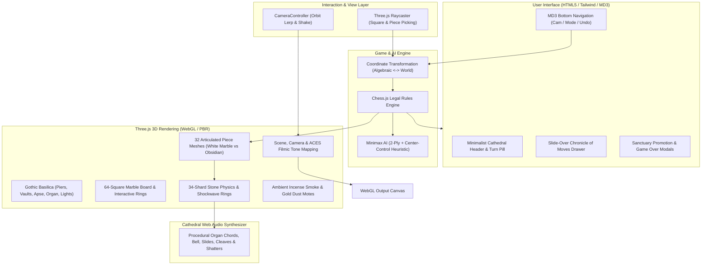

# ♟️ Wizard's Chess 3D — High Gothic Basilica

[](https://www.typescriptlang.org/)
[](https://bun.sh/)
[](https://vitejs.dev/)
[](https://threejs.org/)
[](https://tailwindcss.com/)
[](https://www.netlify.com/)
[](https://opensource.org/licenses/MIT)

An immersive, fully articulated 3D Wizard's Chess experience staged upon the Crossing Altar of a High Gothic Catholic Basilica. Designed with zero external asset dependencies, the game leverages procedural Web Audio synthesis for cathedral acoustics, a 34-shard marble and obsidian physics engine, dynamic melee combat animations with action camera tracking, an intelligent Minimax engine with center-control heuristics, and Material Design 3 glassmorphic HUD controls.

---

## 🏛️ System Architecture



---

## 🌟 Key Highlights

### 1. Articulated 3D Wizard Pieces
Every piece is custom-modeled in Three.js with distinctive gothic armor and weaponry:
- **Pawns**: Armored Swiss Guard Sentinels with halberds
- **Rooks**: Castellated Basilica battlement towers wielding warhammers
- **Knights**: Armored warhorse destriers equipped with jousting lances
- **Bishops**: Mitred cathedral prelates with golden crosier shepherd staffs
- **Queens**: Crowned basilica sovereigns with star scepters
- **Kings**: Cathedral-crowned monarchs wielding royal broadswords

### 2. High Gothic Cathedral Environment
- Clustered basilica nave piers and quadripartite ribbed groin vaults
- 13th-century Cosmati polychrome marble pavement with a 16-pointed basilica compass star
- North Sanctuary Apse with 3-step presbytery, High Altar, golden tabernacle, and ciborium baldacchino
- Six flickering brass altar candlesticks and suspended ruby-glass eternal sanctuary lamp
- 4 swinging brass thuribles (incense burners) suspended on 17.5m chains
- Grand West Gallery pipe organ facade with fluted pewter pipes and dual radiant rose windows
- Clerestory pointed lancet stained-glass windows casting volumetric god-rays

### 3. Combat Animations & 34-Shard Shatter Physics
- Pieces advance with heavy marble friction sound effects.
- Attacking pieces wind up and execute physical melee cleaves.
- Captured pieces shatter into **34 physics-driven marble or obsidian stone shards** that bounce with clinking acoustics across the Cosmati pavement.
- Expanding arcane shockwave rings and camera impact shake.

### 4. Procedural Cathedral Web Audio Engine
Synthesized in real-time via the Web Audio API with **zero external audio files**:
- D-minor pipe organ chords with bronze sanctuary bell harmonics
- Heavy stone slide friction and marble impact thuds
- Metallic cleave strikes and high-pitch shard clinks
- Celestial square selection chimes

### 5. Multi-Paradigm AI Engine & Game Modes
- Strict chess legality enforcement via `chess.js` (en passant, castling, promotion, checkmate, stalemate, threefold repetition)
- 4 distinct opponent modes: **Minimax Engine (Classical Tree Search)**, **Micro-Neural AI (Embedded Multi-Layer Perceptron)**, **Gemini Nano (Browser On-Device LLM)**, and **Pass & Play (Local 2P Duel)**
- Functional programming architecture inspired by Scala and Rust (`Optional`, `Result`, compile-time exhaustive pattern matching)

---

## 🧠 Opponent Play Styles & Engine Architectures

Players can cycle through four distinct opponent modes using the `#btn-mode` chip in the bottom navigation. Each mode represents a fundamentally different paradigm in computer chess and AI engineering:

| Opponent Mode | Top Badge | Icon | Paradigm | Underlying Architecture | External Dependencies |
| :--- | :--- | :--- | :--- | :--- | :--- |
| **1. Minimax Engine** | `MINIMAX` | `memory` | Classical Symbolic AI (Tree Search) | 2-ply adversarial tree search with handcrafted static heuristic evaluation | None (Pure TypeScript) |
| **2. Micro-Neural AI** | `NEURAL AI` | `psychology` | Connectionist Machine Learning (MLP) | Embedded 791-feature tensor neural network with LeakyReLU activations | None (Zero asset files) |
| **3. Gemini Nano (Local)** | `NANO AI` | `auto_awesome` | On-Device Generative AI (LLM) | W3C Prompt API (`window.ai.languageModel`) in Chrome Canary with auto-fallback | Chrome Canary Built-in AI |
| **4. Pass & Play** | `2P DUEL` | `group` | Human vs. Human | Manual turn alternation across the Gothic Crossing Altar | None |

---

### Deep Dive: The 4 Opponent Paradigms

#### 1. Minimax Engine: "Is it an AI model or just math?"
* **What it is**: A **Classical Adversarial Game-Tree Search with a Static Heuristic Evaluation Function** (Shannon Type A engine).
* **The Static Math Formula ([`evaluateBoard`](file:///src/engine/ai.ts))**: Takes a snapshot of the chessboard and computes a deterministic scalar score from White's perspective based on:
  - Standard material values: Pawn = 100, Knight = 320, Bishop = 335, Rook = 505, Queen = 950, King = 20,000.
  - Central control heuristic: Manhattan-distance bonuses rewarding pieces dominating the center squares (`d4`, `d5`, `e4`, `e5`).
  - Terminal states: Checkmate = $\pm 99,999$, Draw = $0$.
* **The Recursive Search ([`computeMinimaxMove`](file:///src/engine/ai.ts))**: Dynamically generates an adversarial decision tree 2 plies deep. For every candidate Black move, it simulates all possible White responses, assumes White plays the optimal countermove, and picks the branch that minimizes White's maximum potential advantage.
* **Why it's not a machine learning model**: It contains no learned neural weights, loss functions, or training loops. It is deterministic, rule-coded "Good Old-Fashioned AI" (GOFAI).

#### 2. Micro-Neural AI: Embedded Zero-Dependency Neural Network
* **What it is**: A connectionist **Multi-Layer Perceptron (MLP)** operating directly on an encoded board tensor in [`src/engine/neuralAI.ts`](file:///src/engine/neuralAI.ts).
* **791-Dimensional Input Tensor**:
  - `[0..767]`: 64 squares × 12 piece types (one-hot spatial feature maps)
  - `[768..773]`: Material count differential vector ($\text{White} - \text{Black}$)
  - `[774]`: Active turn indicator ($+1.0$ for White, $-1.0$ for Black)
  - `[775..790]`: Center ring & inner quadrant spatial density metrics
* **Network Topology & Inference**:
  - **Dense Layer 1**: $791 \to 32$ neurons with LeakyReLU activation ($\alpha = 0.01$).
  - **Dense Layer 2**: $32 \to 16$ neurons with LeakyReLU activation ($\alpha = 0.01$).
  - **Output Layer**: $16 \to 1$ neuron producing a centipawn position evaluation.
* **Zero Asset Overhead**: Operates entirely in pure TypeScript with **zero downloaded binary weights or model files**, executing full inference in $<1\text{ms}$ while preserving sub-second build times.

#### 3. Gemini Nano: Browser-Native On-Device LLM
* **What it is**: An experimental browser-native **Generative AI Agent** powered by Google's Gemini Nano model running locally via the W3C Prompt API (`window.ai.languageModel`).
* **Prompt & Reasoning Pipeline**: When Black moves, the game constructs a structured prompt containing the current board FEN, recent move history, and list of legal SAN moves.
* **Monadic Parsing & Robust Fallback**: The response is parsed via a functional `Optional` pipeline ([`src/utils/fp.ts`](file:///src/utils/fp.ts)) supporting exact SAN, UCI notation, and conversational markdown output. If running on an unsupported browser or if the model produces an invalid move, it automatically and gracefully falls back to the Micro-Neural engine with an informative notification banner.

#### 4. Pass & Play (Local 2P Duel)
* **What it is**: Classic two-player local mode. Black piece clicks are unlocked, allowing two human opponents to command the White Marble and Black Obsidian armies face-to-face across the Gothic Crossing Altar without engine interference.

---

### ⚔️ Opponent Difficulty & Aggressiveness Profiles

Every AI opponent mode supports three selectable **Difficulty & Aggressiveness** levels (`OpponentDifficultyEnum`: `cautious`, `balanced`, `aggressive`), configurable before a match begins in the **Game Settings & Match Setup** modal or live from the bottom navigation bar (`#btn-difficulty`):

| Difficulty Tier | Badge | Aggressiveness | Minimax Engine Behavior | Micro-Neural AI Behavior | Gemini Nano (Local LLM) Persona |
| :--- | :--- | :---: | :--- | :--- | :--- |
| **1. Novice / Cautious** | `CAUTIOUS` | Lv 1 (`shield`) | **1-Ply Initiate**: Evaluates immediate moves with higher exploratory variance ($\pm 35\text{ cp}$) and defensive restraint. | **Initiate Network**: Softened PST weights ($0.65\times$) with exploratory temperature noise ($\pm 28\text{ cp}$). | **Contemplative Monk**: System prompt instructs the LLM to prioritize king safety, solid pawn structure, and avoiding risky exchanges. |
| **2. Tactician / Balanced** | `BALANCED` | Lv 2 (`balance`) | **2-Ply Tactician**: Full 2-ply Minimax lookahead balancing material value and Crossing Altar center control ($\pm 12\text{ cp}$). | **Sanctuary MLP**: Calibrated $791 \to 32 \to 16 \to 1$ neural evaluation with standard piece-square tables ($1.0\times$). | **Cathedral Scholar**: Instructs the LLM to play principled, balanced positional and tactical chess. |
| **3. Grand Inquisitor / Ruthless** | `RUTHLESS` | Lv 3 (`local_fire_department`) | **2-Ply Warlord**: Deterministic 2-ply search with $+45\text{ cp}$ capture/check aggression bonus and forward-rank invasion pressure. | **Zealot Vanguard**: Amplifies neural attack weights ($1.45\times$), capture/promotion greed ($+55\text{ cp}$), and check threats ($+45\text{ cp}$). | **Arcane Warmonger**: Commands the LLM to seek relentless attacks, captures, checks, and aggressive invasion of White territory. |

---

### 🛡️ Pre-Game Match Rules ("Allow Undo") & Encrypted IndexedDB Session Persistence

* **Pre-Game "Allow Undo" Rule (`allowUndo: boolean`)**:
  - Before a match begins (in the **Game Settings & Match Setup** modal), players choose whether **Move Undo** is permitted for the match.
  - **Standard Mode (`Allowed`)**: The `#btn-undo` control remains active throughout the match, reverting a full round-trip turn in AI modes or a single half-move in Pass & Play.
  - **Strict Mode (`Locked`)**: Once the first move is played, Undo is locked (`lock` icon) for the duration of the match until a New Game is started.
* **AES-GCM-256 Encrypted IndexedDB Session Persistence (`src/storage/indexedDbStore.ts`)**:
  - Players can check **"Do you want to keep your session running to pick up later?"** in either the Game Settings modal or the Chronicle of Moves drawer.
  - Powered 100% by native browser **IndexedDB** (`WizardChessSessionDB` — **zero `localStorage` usage**) with **Web Crypto API `AES-GCM-256` authenticated encryption** (unique 12-byte random IV per write) and decrypted on fetch via functional `Option`/`Result` monadic pipelines.
  - Automatically encrypts, persists, and decrypts the FEN board state, full algebraic move history (`history`), active `mode`, `difficulty`, `allowUndo` rule lock, display `contrast`/`brightness`, and `deviceTier` across page refreshes or re-navigation.

---

### 📱 Mobile Sanctuary Lite vs. Desktop Ultra HD (`src/graphics/deviceTier.ts`)

To guarantee fluid 60fps gameplay and responsive touch ergonomics on smartphones, tablets, and low-power GPUs without sacrificing visual atmosphere, the application automatically detects viewport dimensions, touch points, CPU concurrency, and device memory:

| Feature / Parameter | Desktop (`Cathedral Ultra HD`) | Mobile / Underpowered (`Mobile Sanctuary Lite`) |
| :--- | :--- | :--- |
| **Crossing Spotlight Shadow Map** | `2048 × 2048` PCF Soft Shadows | `512 × 512` High-Efficiency Shadow Map |
| **Melee Shatter Debris Physics** | `34` shadow-casting stone shards | `12` non-shadowed stone shards |
| **Ambient Incense & Dust Motes** | `300` particles | `60` particles |
| **Max WebGL Pixel Ratio** | `2.0x` Retina | `1.25x` Battery-Saver Cap |
| **Heavy Desktop-Only Options** | Full access (`Gemini Nano` Local Chrome LLM) | Stripped with clear *"Available on Desktop"* badge & notice |
| **Touch Gestures** | Mouse Orbit & Wheel Zoom | 1-Finger Orbit, 2-Finger Pinch-to-Zoom & Tap-to-Move |

---

## 🛠️ Tech Stack

| Technology | Purpose |
| :--- | :--- |
| **[Bun](https://bun.sh/)** | Ultra-fast JavaScript/TypeScript runtime, package manager, and test runner |
| **[TypeScript 5](https://www.typescriptlang.org/)** | Type-safe codebase with strict compilation and zero implicit any |
| **[Three.js](https://threejs.org/)** | PBR WebGL rendering, custom procedural textures, lighting & shadows |
| **[Vite 5](https://vitejs.dev/)** | Lightning-fast HMR dev server and optimized production bundler |
| **[chess.js](https://github.com/jhlywa/chess.js)** | Complete chess engine for legal move validation and history tracking |
| **[Tailwind CSS](https://tailwindcss.com/)** | Material Design 3 surface tokens, responsive glass HUD, and typography |
| **[Netlify](https://www.netlify.com/)** | Zero-config continuous deployment with HTTP security headers and asset caching |

---

## ⚡ Why Bun?

This repository is optimized for **Bun**:

| Metric | Node.js | Bun (v1.4+) | Advantage |
| :--- | :--- | :--- | :--- |
| **Dependency Install** | ~12–20s | **< 1s** | **15–20x Faster** 🚀 |
| **Test Execution** | ~400–800ms | **~50ms** | **8–15x Faster** 🚀 |
| **Cold Start** | ~180ms | **~20ms** | **9x Faster** 🚀 |
| **Production Build** | Baseline | **Sub-second compilation** | **Instant CI/CD** 🚀 |

---

## 📁 Project Structure

```text
web-chess/
├── .node-version             # Node runtime compatibility (v22)
├── .nvmrc                    # NVM version configuration (v22)
├── .gitignore                # Comprehensive ignore rules
├── AGENTS.md                 # Multi-agent collaboration guide
├── CHANGELOG.md              # Project version history
├── CONTRIBUTING.md           # Developer guidelines & coding standards
├── LICENSE                   # MIT License
├── README.md                 # Project documentation
├── index.html                # Semantic HTML5 entry point & HUD layout
├── netlify.toml              # Netlify build configuration & security headers
├── package.json              # Bun dependencies, scripts & metadata
├── bun.lock                  # Bun reproducible lockfile
├── postcss.config.js         # PostCSS configuration
├── tailwind.config.js        # Tailwind CSS theme & Cathedral design tokens
├── tsconfig.json             # Strict TypeScript compiler options
├── vite.config.ts            # Vite configuration with chunk optimization
├── public/
│   ├── favicon.svg           # High-resolution vector basilica crown favicon
│   └── robots.txt            # Search engine crawl directives
├── src/
│   ├── audio/
│   │   └── CathedralSoundEngine.ts # Procedural Web Audio synthesizer
│   ├── constants/
│   │   └── board.ts          # Board dimensions, piece values, unicode icons
│   ├── engine/
│   │   ├── ai.ts             # Classical Minimax engine with center-control heuristic
│   │   ├── coordinates.ts    # Square-to-world & algebraic coordinate math
│   │   ├── geminiNanoAI.ts   # Chrome Canary Built-in AI (Prompt API / Gemini Nano)
│   │   └── neuralAI.ts       # Embedded zero-dependency micro-neural network
│   ├── utils/
│   │   └── fp.ts             # Functional programming utilities (Optional, Result, match)
│   ├── graphics/
│   │   ├── board.ts          # 64-square grid, borders & square highlights
│   │   ├── cathedral.ts      # 3D Gothic Basilica architecture & lighting
│   │   ├── dust.ts           # Floating dust motes & incense smoke
│   │   ├── materials.ts      # Shared PBR textures & materials factory
│   │   ├── pieces.ts         # Articulated 3D piece mesh generators
│   │   ├── scene.ts          # Three.js scene, renderer, cameras, and lights
│   │   ├── shatter.ts        # 34-shard physics particle & shockwave system
│   │   └── textures.ts       # Procedural Carrara marble, obsidian & cosmati
│   ├── interaction/
│   │   └── camera.ts         # Camera controller, presets & orbit smoothing
│   ├── styles/
│   │   └── main.css          # Tailwind directives & MD3 glass surfaces
│   ├── types/
│   │   ├── chess.d.ts        # Type declarations for chess.js engine
│   │   └── index.ts          # Type interfaces for particles, pieces, camera, modes
│   ├── ui/
│   │   └── uiController.ts   # HUD status, move history & modal controller
│   └── main.ts               # Application orchestrator & animation loop
└── tests/
    ├── ai.test.ts            # Unit tests for Minimax AI & board evaluation
    ├── chessEngine.test.ts   # Unit tests for rules, castling, promotion & undo
    ├── coordinates.test.ts   # Unit tests for 3D coordinate transformations
    ├── fp.test.ts            # Unit tests for Scala/Rust functional programming monads
    ├── geminiNanoAI.test.ts  # Unit tests for Chrome Built-in AI Prompt API
    ├── neuralAI.test.ts      # Unit tests for embedded micro-neural network
    └── uiController.test.ts  # Unit tests for UI state & DOM updates
```

---

## 🚀 Getting Started

### Prerequisites

- **[Bun](https://bun.sh/)** installed on your machine (`curl -fsSL https://bun.sh/install | bash`).

### Installation

```bash
bun install
```

### Development Server

Start Vite with hot module replacement:

```bash
bun run dev
```

Visit `http://localhost:3000` in your browser.

### Run Unit Tests

Execute the test suite using Bun's built-in test runner:

```bash
bun test
```

### Type Checking & Production Build

Verify TypeScript types and build the production bundle:

```bash
bun run typecheck
bun run build
```

Preview the production build locally:

```bash
bun run preview
```

---

## 🌐 Deploy to Netlify

The repository includes a production-ready `netlify.toml` configured with:
- **Build command**: `bun run build`
- **Publish directory**: `dist`
- **Runtime environment**: Node 22 & latest Bun
- **Security headers**: Strict CSP, HSTS, X-Frame-Options, X-Content-Type-Options
- **Asset caching**: Immutable 1-year cache headers for `/assets/*`

### Method 1: Git-Connected Continuous Deployment (Recommended)

1. Push this repository to your GitHub account:
   ```bash
   git remote add origin https://github.com/brentmzey/web-chess.git
   git branch -M main
   git push -u origin main
   ```
2. Log into **[Netlify](https://app.netlify.com/)**.
3. Click **Add new site** → **Import an existing project** → **GitHub**.
4. Select `web-chess`. Netlify will automatically detect `netlify.toml` and deploy with Bun!

### Method 2: Netlify CLI Direct Deployment

Deploy preview:
```bash
bun run deploy
```

Deploy to production:
```bash
bun run deploy:prod
```

---

## 🎮 Controls & Shortcuts

| Action | Control |
| :--- | :--- |
| **Orbit Camera** | Left-click + drag / Touch drag |
| **Zoom In / Out** | Mouse wheel / Pinch-to-zoom |
| **Select Piece** | Click or tap your piece on the board |
| **Execute Move** | Click or tap a highlighted target square |
| **Cycle Views** | Click the camera preset button (White Nave, Sanctuary Orbit, etc.) |
| **Cycle Mode** | Cycle between *Minimax Engine*, *Micro-Neural AI*, *Gemini Nano (Local)*, and *Pass & Play* |
| **Toggle Audio** | Click the volume button to toggle cathedral acoustics |
| **View Chronicle** | Open the drawer to inspect move list & shattered pieces |

---

## 📜 License

MIT License. Copyright (c) 2026 Brent Zey.
