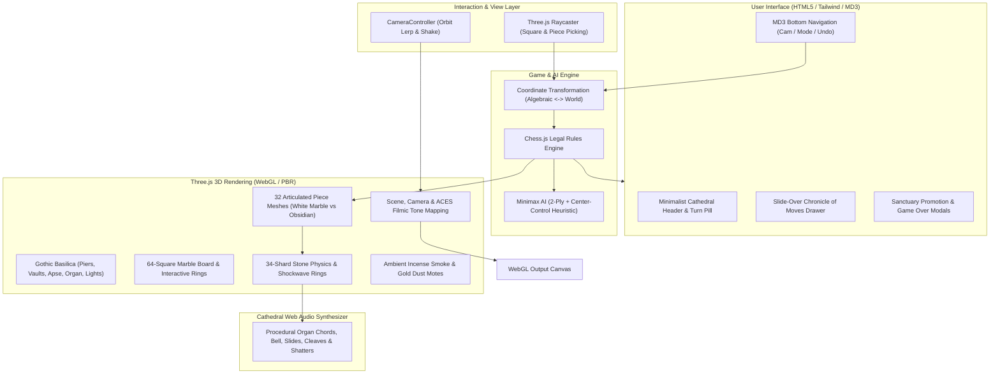

# ♟️ Wizard's Chess 3D — High Gothic Basilica

[](https://www.typescriptlang.org/)
[](https://bun.sh/)
[](https://vitejs.dev/)
[](https://threejs.org/)
[](https://tailwindcss.com/)
[](https://www.netlify.com/)
[](https://opensource.org/licenses/MIT)

An immersive, fully articulated 3D Wizard's Chess experience staged upon the Crossing Altar of a High Gothic Catholic Basilica. Designed with zero external asset dependencies, the game leverages procedural Web Audio synthesis for cathedral acoustics, a 34-shard marble and obsidian physics engine, dynamic melee combat animations with action camera tracking, an intelligent Minimax engine with center-control heuristics, and Material Design 3 glassmorphic HUD controls.

---

## 🏛️ System Architecture



---

## 🌟 Key Highlights

### 1. Articulated 3D Wizard Pieces
Every piece is custom-modeled in Three.js with distinctive gothic armor and weaponry:
- **Pawns**: Armored Swiss Guard Sentinels with halberds
- **Rooks**: Castellated Basilica battlement towers wielding warhammers
- **Knights**: Armored warhorse destriers equipped with jousting lances
- **Bishops**: Mitred cathedral prelates with golden crosier shepherd staffs
- **Queens**: Crowned basilica sovereigns with star scepters
- **Kings**: Cathedral-crowned monarchs wielding royal broadswords

### 2. High Gothic Cathedral Environment
- Clustered basilica nave piers and quadripartite ribbed groin vaults
- 13th-century Cosmati polychrome marble pavement with a 16-pointed basilica compass star
- North Sanctuary Apse with 3-step presbytery, High Altar, golden tabernacle, and ciborium baldacchino
- Six flickering brass altar candlesticks and suspended ruby-glass eternal sanctuary lamp
- 4 swinging brass thuribles (incense burners) suspended on 17.5m chains
- Grand West Gallery pipe organ facade with fluted pewter pipes and dual radiant rose windows
- Clerestory pointed lancet stained-glass windows casting volumetric god-rays

### 3. Combat Animations & 34-Shard Shatter Physics
- Pieces advance with heavy marble friction sound effects.
- Attacking pieces wind up and execute physical melee cleaves.
- Captured pieces shatter into **34 physics-driven marble or obsidian stone shards** that bounce with clinking acoustics across the Cosmati pavement.
- Expanding arcane shockwave rings and camera impact shake.

### 4. Procedural Cathedral Web Audio Engine
Synthesized in real-time via the Web Audio API with **zero external audio files**:
- D-minor pipe organ chords with bronze sanctuary bell harmonics
- Heavy stone slide friction and marble impact thuds
- Metallic cleave strikes and high-pitch shard clinks
- Celestial square selection chimes

### 5. Wizard AI & Game Engine
- Strict chess legality enforcement via `chess.js` (en passant, castling, promotion, checkmate, stalemate, threefold repetition)
- 2-ply Minimax engine with center-control positional evaluation and capture sorting
- 1-Player vs. Wizard AI or 2-Player Pass & Play local duel modes

---

## 🛠️ Tech Stack

| Technology | Purpose |
| :--- | :--- |
| **[Bun](https://bun.sh/)** | Ultra-fast JavaScript/TypeScript runtime, package manager, and test runner |
| **[TypeScript 5](https://www.typescriptlang.org/)** | Type-safe codebase with strict compilation and zero implicit any |
| **[Three.js](https://threejs.org/)** | PBR WebGL rendering, custom procedural textures, lighting & shadows |
| **[Vite 5](https://vitejs.dev/)** | Lightning-fast HMR dev server and optimized production bundler |
| **[chess.js](https://github.com/jhlywa/chess.js)** | Complete chess engine for legal move validation and history tracking |
| **[Tailwind CSS](https://tailwindcss.com/)** | Material Design 3 surface tokens, responsive glass HUD, and typography |
| **[Netlify](https://www.netlify.com/)** | Zero-config continuous deployment with HTTP security headers and asset caching |

---

## ⚡ Why Bun?

This repository is optimized for **Bun**:

| Metric | Node.js | Bun (v1.4+) | Advantage |
| :--- | :--- | :--- | :--- |
| **Dependency Install** | ~12–20s | **< 1s** | **15–20x Faster** 🚀 |
| **Test Execution** | ~400–800ms | **~50ms** | **8–15x Faster** 🚀 |
| **Cold Start** | ~180ms | **~20ms** | **9x Faster** 🚀 |
| **Production Build** | Baseline | **Sub-second compilation** | **Instant CI/CD** 🚀 |

---

## 📁 Project Structure

```text
web-chess/
├── .node-version             # Node runtime compatibility (v22)
├── .nvmrc                    # NVM version configuration (v22)
├── .gitignore                # Comprehensive ignore rules
├── AGENTS.md                 # Multi-agent collaboration guide
├── CHANGELOG.md              # Project version history
├── CONTRIBUTING.md           # Developer guidelines & coding standards
├── LICENSE                   # MIT License
├── README.md                 # Project documentation
├── index.html                # Semantic HTML5 entry point & HUD layout
├── netlify.toml              # Netlify build configuration & security headers
├── package.json              # Bun dependencies, scripts & metadata
├── bun.lock                  # Bun reproducible lockfile
├── postcss.config.js         # PostCSS configuration
├── tailwind.config.js        # Tailwind CSS theme & Cathedral design tokens
├── tsconfig.json             # Strict TypeScript compiler options
├── vite.config.ts            # Vite configuration with chunk optimization
├── public/
│   ├── favicon.svg           # High-resolution vector basilica crown favicon
│   └── robots.txt            # Search engine crawl directives
├── src/
│   ├── audio/
│   │   └── CathedralSoundEngine.ts # Procedural Web Audio synthesizer
│   ├── constants/
│   │   └── board.ts          # Board dimensions, piece values, unicode icons
│   ├── engine/
│   │   ├── ai.ts             # Minimax algorithm with center-control heuristic
│   │   └── coordinates.ts    # Square-to-world & algebraic coordinate math
│   ├── graphics/
│   │   ├── board.ts          # 64-square grid, borders & square highlights
│   │   ├── cathedral.ts      # 3D Gothic Basilica architecture & lighting
│   │   ├── dust.ts           # Floating dust motes & incense smoke
│   │   ├── materials.ts      # Shared PBR textures & materials factory
│   │   ├── pieces.ts         # Articulated 3D piece mesh generators
│   │   ├── scene.ts          # Three.js scene, renderer, cameras, and lights
│   │   ├── shatter.ts        # 34-shard physics particle & shockwave system
│   │   └── textures.ts       # Procedural Carrara marble, obsidian & cosmati
│   ├── interaction/
│   │   └── camera.ts         # Camera controller, presets & orbit smoothing
│   ├── styles/
│   │   └── main.css          # Tailwind directives & MD3 glass surfaces
│   ├── types/
│   │   ├── chess.d.ts        # Type declarations for chess.js engine
│   │   └── index.ts          # Type interfaces for particles, pieces, camera
│   ├── ui/
│   │   └── uiController.ts   # HUD status, move history & modal controller
│   └── main.ts               # Application orchestrator & animation loop
└── tests/
    ├── ai.test.ts            # Unit tests for Minimax AI & board evaluation
    ├── chessEngine.test.ts   # Unit tests for rules, castling, promotion & undo
    └── coordinates.test.ts   # Unit tests for 3D coordinate transformations
```

---

## 🚀 Getting Started

### Prerequisites

- **[Bun](https://bun.sh/)** installed on your machine (`curl -fsSL https://bun.sh/install | bash`).

### Installation

```bash
bun install
```

### Development Server

Start Vite with hot module replacement:

```bash
bun run dev
```

Visit `http://localhost:3000` in your browser.

### Run Unit Tests

Execute the test suite using Bun's built-in test runner:

```bash
bun test
```

### Type Checking & Production Build

Verify TypeScript types and build the production bundle:

```bash
bun run typecheck
bun run build
```

Preview the production build locally:

```bash
bun run preview
```

---

## 🌐 Deploy to Netlify

The repository includes a production-ready `netlify.toml` configured with:
- **Build command**: `bun run build`
- **Publish directory**: `dist`
- **Runtime environment**: Node 22 & latest Bun
- **Security headers**: Strict CSP, HSTS, X-Frame-Options, X-Content-Type-Options
- **Asset caching**: Immutable 1-year cache headers for `/assets/*`

### Method 1: Git-Connected Continuous Deployment (Recommended)

1. Push this repository to your GitHub account:
   ```bash
   git remote add origin https://github.com/brentmzey/web-chess.git
   git branch -M main
   git push -u origin main
   ```
2. Log into **[Netlify](https://app.netlify.com/)**.
3. Click **Add new site** → **Import an existing project** → **GitHub**.
4. Select `web-chess`. Netlify will automatically detect `netlify.toml` and deploy with Bun!

### Method 2: Netlify CLI Direct Deployment

Deploy preview:
```bash
bun run deploy
```

Deploy to production:
```bash
bun run deploy:prod
```

---

## 🎮 Controls & Shortcuts

| Action | Control |
| :--- | :--- |
| **Orbit Camera** | Left-click + drag / Touch drag |
| **Zoom In / Out** | Mouse wheel / Pinch-to-zoom |
| **Select Piece** | Click or tap your piece on the board |
| **Execute Move** | Click or tap a highlighted target square |
| **Cycle Views** | Click the camera preset button (White Nave, Sanctuary Orbit, etc.) |
| **Toggle Mode** | Switch between *Wizard AI* and *2-Player Pass & Play* |
| **Toggle Audio** | Click the volume button to toggle cathedral acoustics |
| **View Chronicle** | Open the drawer to inspect move list & shattered pieces |

---

## 📜 License

MIT License. Copyright (c) 2026 Brent Zey.
