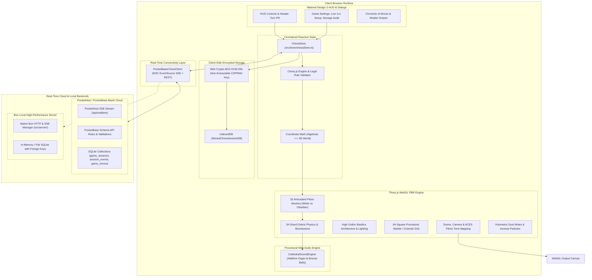

# 🏛️ Architecture Guide — Wizard's Chess 3D

This document provides a comprehensive technical overview of the system architecture, state flow, rendering pipeline, multi-agent AI execution, real-time multiplayer synchronization, and encrypted client storage in **Wizard's Chess 3D**.

---

## 🧭 High-Level Architecture Overview

---

## 📦 Key Subsystems

### 1. Centralized Reactive State Store ([`src/store/chessStore.ts`](file:///Users/brentzey/personal/web-chess/src/store/chessStore.ts))
The `ChessStore` acts as the single source of truth for all game configurations, active match snapshots, and player preferences:
* **State Encapsulation**: Manages FEN notation, algebraic move history, selected game mode, difficulty profile, strict mode lock (`allowUndo`), theme, action camera toggle, display parameters (`contrast`, `brightness`), and live session credentials.
* **Reactive Subscriptions**: Components subscribe via functional callbacks (`store.subscribe(listener)`), triggering automatic UI updates upon state transitions.
* **Tab-Refresh Rehydration**: Encrypts and persists active matches to IndexedDB upon every move or configuration change, seamlessly rehydrating board positions and reconnecting live 1v1 sessions across browser reloads or unloads.

---

### 2. Multi-Paradigm Chess AI Engine
The game supports four fundamentally different computer chess architectures:

1. **Minimax Engine (Classical Tree Search, [`src/engine/ai.ts`](file:///Users/brentzey/personal/web-chess/src/engine/ai.ts))**:
   - 2-ply adversarial tree search with Shannon Type A minimax optimization.
   - Evaluates material values and central spatial control using Manhattan distance heuristics.
2. **Micro-Neural AI (Connectionist Machine Learning, [`src/engine/neuralAI.ts`](file:///Users/brentzey/personal/web-chess/src/engine/neuralAI.ts))**:
   - Embedded Multi-Layer Perceptron (MLP) operating on a 791-dimensional spatial feature vector.
   - Evaluates board dynamics through Dense layers ($791 \to 32 \to 16 \to 1$) with LeakyReLU activations in $<1\text{ms}$ with zero downloaded weight files.
3. **Gemini Nano On-Device LLM ([`src/engine/geminiNanoAI.ts`](file:///Users/brentzey/personal/web-chess/src/engine/geminiNanoAI.ts))**:
   - Uses Chrome's experimental W3C Prompt API (`window.ai.languageModel`).
   - Translates difficulty levels into distinct persona prompts (Contemplative Monk, Cathedral Scholar, Arcane Warmonger).
   - Features monadic fallback to Micro-Neural AI on unsupported browsers or malformed responses.
4. **Pass & Play (Local 2P Duel)**:
   - Direct human vs. human play across the 3D Crossing Altar with full legality checks.

---

### 3. Procedural Three.js 3D Graphics & Particle Systems
* **High Gothic Basilica Architecture ([`src/graphics/cathedral.ts`](file:///Users/brentzey/personal/web-chess/src/graphics/cathedral.ts))**:
  - Clustered nave piers, pointed ribbed groin vaults, ambulatory sanctuary apse, golden tabernacle, and west gallery pipe organ.
  - Volumetric lighting with ACES Filmic tone mapping and soft PCF shadow maps.
* **34-Shard Debris Shatter Physics ([`src/graphics/shatter.ts`](file:///Users/brentzey/personal/web-chess/src/graphics/shatter.ts))**:
  - Captured pieces dynamically break apart into 34 physics-simulated marble or obsidian shards.
  - Shards bounce and slide with procedural friction and gravity against the Cosmati pavement.
* **Procedural Textures Factory ([`src/graphics/textures.ts`](file:///Users/brentzey/personal/web-chess/src/graphics/textures.ts))**:
  - Generates Carrara white marble, black obsidian, dark oak, and polished brass textures dynamically on HTML5 `<canvas>` with zero external image files.
* **Swappable Cathedral Themes ([`src/constants/board.ts`](file:///Users/brentzey/personal/web-chess/src/constants/board.ts), [`src/graphics/materials.ts`](file:///Users/brentzey/personal/web-chess/src/graphics/materials.ts))**:
  - High Gothic Basilica (Classic Carrara & Obsidian)
  - Emerald Citadel (Malachite & Forest Jade)
  - Golden Sanctuary (Imperial Byzantine Gold & Travertine)
  - Obsidian Crypt (Volcanic Basalt & Glowing Magma Runes)

---

### 4. Real-Time Multiplayer Architecture ([`src/realtime/`](file:///Users/brentzey/personal/web-chess/src/realtime/))
* **PocketHost / PocketBase BaaS Cloud Backend**:
  - Leverages PocketHost's serverless edge infrastructure with automatic hibernation and instant wake-up.
  - Real-time event streaming over W3C Server-Sent Events (`/api/realtime`).
  - Strict collection API security rules and monotonic event validation.
* **Dual-Stack Support**:
  - Automatically interfaces with cloud PocketHost (`https://web-chess.pockethost.io`) or local Bun server (`src/server/`).
  - URL-first invite mechanism (`?session=SANCT-XXXX`) for instant one-click match joining.

---

### 5. Encrypted Client Storage ([`src/storage/indexedDbStore.ts`](file:///Users/brentzey/personal/web-chess/src/storage/indexedDbStore.ts))
* **AES-GCM-256 Web Crypto Persistence**:
  - Uses an origin-bound, non-extractable 256-bit Web Crypto key stored directly in IndexedDB.
  - Zero hardcoded keys or unencrypted plaintext payloads at rest.
  - Cryptographically bound to storage contexts via Additional Authenticated Data (AAD).
  - Storage audit report tool displaying encrypted-only envelopes without plaintext exposure.

---

### 6. ECMAScript Temporal API & Day.js Fallback ([`src/utils/dateTime.ts`](file:///Users/brentzey/personal/web-chess/src/utils/dateTime.ts))
* **Modern Temporal API Adoption**:
  - All date, time, and timestamp operations run through `currentEpochMs()`, `nowIso()`, and `formatDateTime()`.
  - Automatically checks `isTemporalSupported()`, executing modern ECMAScript `Temporal` operations when available.
  - Gracefully falls back to `Day.js` (with UTC, timezone, and advanced format plugins) on older platforms or on runtime exceptions.
