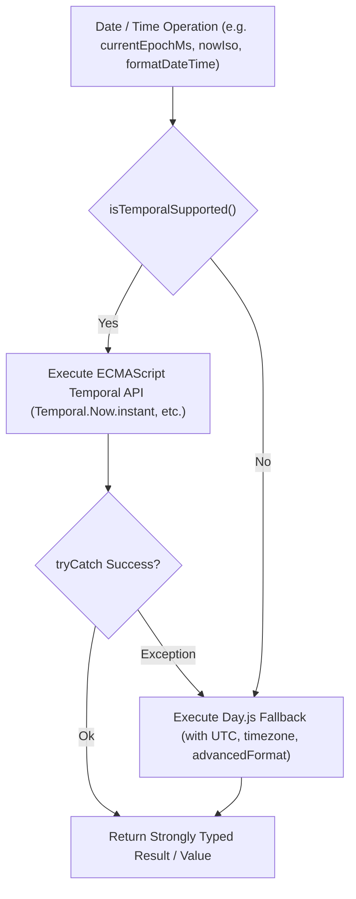

# ⏱️ Date & Time Architecture — ECMAScript Temporal API with Day.js Fallback

This document details the datetime architecture, standardization, and execution models used across **Wizard's Chess 3D**.

---

## 📅 Overview

To prepare the application for future ECMAScript standards while maintaining 100% backward compatibility across all modern browsers, smartphones, and server runtimes, all date and timestamp operations are centralized within [`src/utils/dateTime.ts`](file:///Users/brentzey/personal/web-chess/src/utils/dateTime.ts).



---

## 🛠️ Unified API Primitives

| Function | Primary (Temporal API) | Fallback (Day.js) | Purpose |
|---|---|---|---|
| `currentEpochMs()` | `Temporal.Now.instant().epochMilliseconds` | `dayjs().valueOf()` | Milliseconds since Unix epoch; used for monotonic sequences, event timers, and database record timestamps. |
| `nowIso()` | `Temporal.Now.instant().toString()` | `dayjs().toISOString()` | Full ISO 8601 timestamp string for logging, audit reports, and metadata. |
| `epochMsToIso(millis)` | `Temporal.Instant.fromEpochMilliseconds(millis).toString()` | `dayjs(millis).toISOString()` | Converts numeric epoch milliseconds to ISO 8601 format. |
| `isoToEpochMs(iso)` | `Temporal.Instant.from(iso).epochMilliseconds` | `dayjs(iso).valueOf()` | Parses ISO strings to numeric epoch milliseconds. |
| `formatDateTime(opt)` | `Temporal.Instant.from(val).toZonedDateTimeISO(...)` | `dayjs(val).format('MM/DD/YYYY, hh:mm A')` | Monad-safe formatting accepting `Option<string>`, string, `null`, or `undefined`. |

---

## 🛡️ Monadic Error Handling & Fallback Safety

The `withFallback` helper wraps all operations using functional monads (`tryCatch` and `matchBool` from `src/utils/fp.ts`):

```typescript
export function withFallback<T>(
  operationName: string,
  temporalFn: (temporal: Record<string, any>) => T,
  fallbackFn: () => T
): T {
  return matchBool(isTemporalSupported(), {
    true: () => {
      const res = tryCatch(() => temporalFn(getTemporal()), toError);
      return res.match({
        Ok: val => val,
        Err: err => {
          if (typeof console !== 'undefined' && console.warn) {
            console.warn(`Temporal failure in ${operationName}, falling back to Day.js:`, err);
          }
          return fallbackFn();
        }
      });
    },
    false: () => fallbackFn()
  });
}
```

### Key Safety Guarantees:
1. **Zero Uncaught Exceptions**: If a browser's experimental `Temporal` implementation throws a parsing or runtime error, `withFallback` intercepts it cleanly and falls back to `Day.js`.
2. **Zero Circular Dependencies**: The datetime module contains zero circular dependencies, allowing logger, storage, realtime, and UI components to import it safely.
3. **Deterministic Automated Testing**: Includes `setTemporalOverride(overrideOpt)` to simulate both Temporal support and Day.js fallback in CI/CD test runners.
