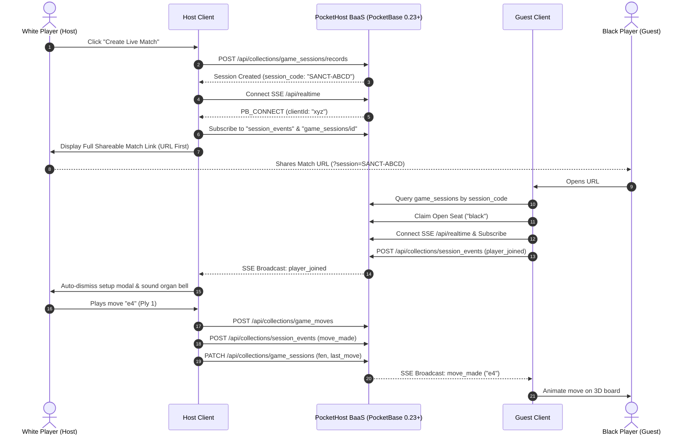

# 🌐 Real-Time Multiplayer Guide — PocketHost & PocketBase Architecture

This guide explains the design, setup, security model, and execution flow of the **Real-Time 1v1 Multiplayer** engine in **Wizard's Chess 3D**.

---

## ⚡ Architecture & Connection Flow

The real-time multiplayer engine is built natively upon **PocketBase** and hosted on **PocketHost** (`https://web-chess.pockethost.io`), with dual-stack compatibility for a local Bun server.



---

## 🔗 URL-First Match Setup & Invite Flow

The Live Match Setup dialog ([`index.html`](file:///Users/brentzey/personal/web-chess/index.html#L669-L715)) is optimized for maximum clarity and zero friction:

1. **Primary: Direct Match Link (Recommended)**:
   - Immediately generates and presents the full, clickable match link:
     ```text
     https://web-chess-app.netlify.app/?session=SANCT-XXXX
     ```
   - Features a one-click **"Copy Link"** button with automatic clipboard integration.
   - When opened by the opponent, the application automatically detects the `?session=` parameter, skips the creation dialog, and enters the match room seamlessly.
2. **Secondary: Manual Match Code**:
   - Displays the 6-character alphanumeric match code (`SANCT-XXXX`) alongside a **"Copy Code"** button for players entering manually from another device.
3. **Immediate Board Entry**:
   - The host can click **"Enter Sanctuary Board & Wait"** (`#btn-enter-live-match`) or dismiss the modal by clicking outside on the darkened backdrop or pressing `Escape`.
   - The host is placed directly in the 3D sanctuary, and the game automatically transitions into active play the moment the opponent connects.

---

## 🪑 Seat Assignment & Camera Perspective

* **White Player (Host)**: 3D camera default orientation faces White's home rank (`theta = 0`).
* **Black Player (Guest)**: Upon claiming the Black seat, the 3D camera automatically smoothly rotates 180 degrees (`theta = Math.PI`), framing the board naturally from Black's perspective.
* **Spectator Mode**: If both White and Black seats are claimed, subsequent joiners enter as spectators. Spectator mode displays a dedicated notice and disables direct piece interactions while streaming all moves in real time.
* **Seat Reclamation on Tab Refresh**: If a player refreshes their browser during an active match, their seat assignment and credentials are automatically restored from encrypted IndexedDB (`restoreSessionIfEnabled`), reconnecting to the SSE stream without losing their turn or being locked out.

---

## 🔒 Security Rules & Abuse Prevention

The PocketHost schema is protected by defense-in-depth security policies:

### 1. Database Collection API Rules ([`src/server/pocketbase/schema.json`](file:///Users/brentzey/personal/web-chess/src/server/pocketbase/schema.json))

| Collection | Create Rule | Update Rule | Delete Rule | Security Guarantee |
|---|---|---|---|---|
| `game_sessions` | `session_code != "" && fen != ""` | `status != ""` | `null` (Forbidden) | Prevents public deletion of matches; requires valid session code and initial FEN. |
| `session_participants` | `player_name != "" && role != ""` | `role != ""` | `null` (Forbidden) | Prevents deleting participant records. |
| `game_moves` | `san != "" && ply > 0` | `null` (Forbidden) | `null` (Forbidden) | **Strictly append-only**: moves can never be overwritten, modified, or deleted once submitted. |
| `session_events` | `event_type != "" && event_seq > 0` | `null` (Forbidden) | `null` (Forbidden) | **Immutable audit log**: events cannot be altered or wiped by unauthorized clients. |

### 2. Client-Side Input Sanitization & Guardrails
* **Input Sanitization**: All user strings are scrubbed via [`sanitizeTextInput`](file:///Users/brentzey/personal/web-chess/src/realtime/pocketbaseClient.ts#L14) and [`sanitizeSessionCode`](file:///Users/brentzey/personal/web-chess/src/realtime/pocketbaseClient.ts#L18) to strip HTML tags, script injection, and illegal characters.
* **Duplicate Move Guard**: Moves enforce monotonic ply validation (`if (this.lastMovePly === payload.ply) throw Error(...)`), preventing double-click move spam without impacting fast-turn play.
* **Production Console Obfuscation**: In production mode (`!isDevMode()`), internal collection names, raw SSE topic routes, and client IDs are suppressed from browser console inspection.

---

## 🛠️ Schema Migrations Tooling

To apply or update PocketHost schema rules without exposing administrative credentials:

```bash
# Sourced automatically from ~/.zshrc (PB_ADMIN_EMAIL & PB_ADMIN_PASSWORD)
bun run pb:migrate
```

The migration runner ([`scripts/pb-migrate.ts`](file:///Users/brentzey/personal/web-chess/scripts/pb-migrate.ts)) authenticates with PocketBase's superuser API, resolves collection relations, applies field constraints, and enforces API rules with zero secret leaks.
