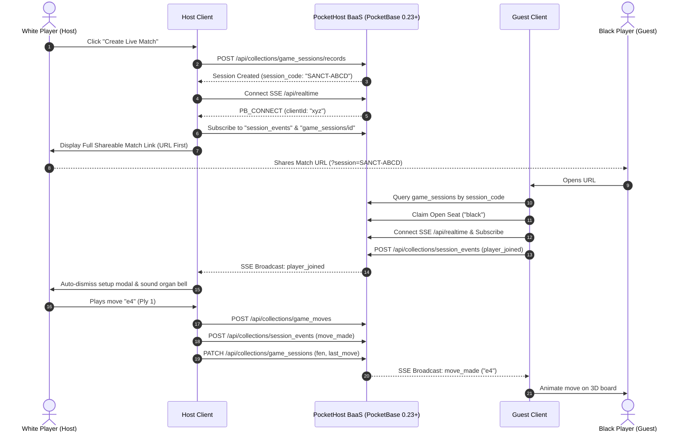

# 🌐 Real-Time Multiplayer Guide — PocketHost & PocketBase Architecture

This guide explains the design, setup, security model, and execution flow of the **Real-Time 1v1 Multiplayer** engine in **Wizard's Chess 3D**.

---

## ⚡ Architecture & Connection Flow

The real-time multiplayer engine is built natively upon **PocketBase** and hosted on **PocketHost** (`https://web-chess.pockethost.io`), with dual-stack compatibility for a local Bun server.



---

## 🔗 URL-First Match Setup & Invite Flow

The Live Match Setup dialog ([`index.html`](file:///Users/brentzey/personal/web-chess/index.html#L669-L715)) is optimized for maximum clarity and zero friction:

1. **Primary: Direct Match Link (Recommended)**:
   - Immediately generates and presents the full, clickable match link:
     ```text
     https://web-chess-app.netlify.app/?session=SANCT-XXXX
     ```
   - Features a one-click **"Copy Link"** button with automatic clipboard integration.
   - When opened by the opponent, the application automatically detects the `?session=` parameter, skips the creation dialog, and enters the match room seamlessly.
2. **Secondary: Manual Match Code**:
   - Displays the 6-character alphanumeric match code (`SANCT-XXXX`) alongside a **"Copy Code"** button for players entering manually from another device.
3. **Immediate Board Entry & Persistent In-Game Share HUD**:
   - The host can click **"Enter Sanctuary Board & Wait"** (`#btn-enter-live-match`) or dismiss the modal by clicking outside on the darkened backdrop or pressing `Escape`.
   - **Persistent In-Game HUD Bar (`#live-persistent-hud`)**:
     - Whenever a Live 1v1 match is active, a floating pill appears directly below the top turn indicator on the 3D board canvas.
     - Features a prominent **"Copy Link"** button (`#btn-persistent-copy-link`) with instant clipboard copying, auditory chime feedback, and temporary "Copied!" check confirmation.
     - Displays the 6-character match code with a quick **"Code"** button (`#btn-persistent-copy-code`) for immediate sharing.
     - Includes a persistent **"Pin"** toggle button (`#btn-persistent-toggle-pin`) allowing players to protect the match from automated 3-day cleanup at any time without opening any modals.
   - The host is placed directly in the 3D sanctuary, and the game automatically transitions into active play the moment the opponent connects.

---

## 🪑 Seat Assignment & Camera Perspective

* **White Player (Host)**: 3D camera default orientation faces White's home rank (`theta = 0`).
* **Black Player (Guest)**: Upon claiming the Black seat, the 3D camera automatically smoothly rotates 180 degrees (`theta = Math.PI`), framing the board naturally from Black's perspective.
* **Spectator Mode**: If both White and Black seats are claimed, subsequent joiners enter as spectators. Spectator mode displays a dedicated notice and disables direct piece interactions while streaming all moves in real time.
* **Seat Reclamation on Tab Refresh**: If a player refreshes their browser during an active match, their seat assignment and credentials are automatically restored from encrypted IndexedDB (`restoreSessionIfEnabled`), reconnecting to the SSE stream without losing their turn or being locked out.

---

## 🛡️ Session Integrity & Opponent Mode Locking

To prevent accidental corruption of active live matches (such as local AI engines evaluating and overriding peer moves, or wiping the session state mid-game):
* **Bottom Bar Mode Locking (`#btn-mode`)**: The mode chip is visually locked (`cursor-not-allowed`) and guarded against cycling away from Live Mode. Clicking it displays a notification that the match is locked to the remote peer.
* **Pre-Game Settings Locking (`#pregame-modal`)**: In the match settings modal, all non-live opponent mode options (Pass & Play, Minimax Engine, Micro-Neural, and Gemini Nano) are disabled (`disabled = true`, `opacity-30`, `pointer-events-none`) with a visual `Locked in Live Match` badge (`#pregame-mode-lock-notice`).
* **Programmatic Mode Guards**: `selectGameMode` enforces that mode transitions away from `GameModeEnum.Live` are rejected while an active session exists.
* **Deliberate Match Exit (`#btn-leave-live-session`)**: Players who wish to conclude or exit an active match can do so cleanly via the "Leave Match" action in the Live Session modal (`#live-active-banner`), which disconnects the SSE client, clears encrypted live session data, purges URL parameters, and safely restores solo Minimax play.

---

## 🔒 Security Rules & Abuse Prevention

The PocketHost schema is protected by defense-in-depth security policies:

### 1. Database Collection API Rules ([`src/server/pocketbase/schema.json`](file:///Users/brentzey/personal/web-chess/src/server/pocketbase/schema.json))

| Collection | Create Rule | Update Rule | Delete Rule | Security Guarantee |
|---|---|---|---|---|
| `game_sessions` | `session_code != "" && fen != ""` | `status != ""` | `null` (Forbidden) | Prevents public deletion of matches; requires valid session code and initial FEN. |
| `session_participants` | `player_name != "" && role != ""` | `role != ""` | `null` (Forbidden) | Prevents deleting participant records. |
| `game_moves` | `san != "" && ply > 0` | `null` (Forbidden) | `null` (Forbidden) | **Strictly append-only**: moves can never be overwritten, modified, or deleted once submitted. |
| `session_events` | `event_type != "" && event_seq > 0` | `null` (Forbidden) | `null` (Forbidden) | **Immutable audit log**: events cannot be altered or wiped by unauthorized clients. |

### 2. Client-Side Input Sanitization & Guardrails
* **Input Sanitization**: All user strings are scrubbed via [`sanitizeTextInput`](file:///Users/brentzey/personal/web-chess/src/realtime/pocketbaseClient.ts#L14) and [`sanitizeSessionCode`](file:///Users/brentzey/personal/web-chess/src/realtime/pocketbaseClient.ts#L18) to strip HTML tags, script injection, and illegal characters.
* **Duplicate Move Guard**: Moves enforce monotonic ply validation (`if (this.lastMovePly === payload.ply) throw Error(...)`), preventing double-click move spam without impacting fast-turn play.
* **Production Console Obfuscation**: In production mode (`!isDevMode()`), internal collection names, raw SSE topic routes, and client IDs are suppressed from browser console inspection.

---

## ⚡ Indexing Architecture & Query Optimization

To guarantee sub-millisecond query latency and sub-10ms real-time event distribution under high concurrent duels, all PocketHost collections feature dedicated compound and single-column B-tree indices:

| Collection | Index Name | Expression / Columns | Query Optimization Purpose |
|---|---|---|---|
| `game_sessions` | `idx_game_sessions_code` | `UNIQUE(session_code)` | Instant O(1) room lookup by code or invite link. |
| `game_sessions` | `idx_game_sessions_status` | `(status)` | Fast filtering of active vs. concluded matches. |
| `game_sessions` | `idx_game_sessions_created` | `(created)` | Range scans for stale session detection and pruning. |
| `game_sessions` | `idx_game_sessions_updated` | `(updated)` | Fast retrieval of recently active boards. |
| `game_sessions` | `idx_game_sessions_status_created` | `(status, created)` | Compound query optimization for active session sweeps. |
| `session_participants` | `idx_participants_session` | `(session)` | Foreign key relational joins and session fanout. |
| `session_participants` | `idx_participants_session_role` | `(session, role)` | Rapid seat assignment checks (`white` / `black` occupancy). |
| `session_participants` | `idx_participants_created` | `(created)` | Participant join ordering and chronological audits. |
| `game_moves` | `idx_moves_session_ply` | `UNIQUE(session, ply)` | Monotonic ply integrity and ordered move log retrieval. |
| `game_moves` | `idx_moves_session` | `(session)` | Fast aggregation of move count and game length. |
| `game_moves` | `idx_moves_session_created` | `(session, created)` | Chronological move timing analysis and catch-up streams. |
| `session_events` | `idx_events_session_seq` | `UNIQUE(session, event_seq)` | W3C `Last-Event-ID` SSE catch-up replay. |
| `session_events` | `idx_events_session` | `(session)` | Foreign key event lifecycle cascade joins. |
| `session_events` | `idx_events_session_type` | `(session, event_type)` | Selective event type queries (e.g. moves, resignations). |
| `session_events` | `idx_events_created` | `(created)` | SSE event emission ordering and telemetry. |
| `tbl_audit_cleanup_logs` | `idx_tbl_audit_trace` | `UNIQUE(txt_trace_id)` | Instant lookup by cleanup trace correlation ID. |
| `tbl_audit_cleanup_logs` | `idx_tbl_audit_created` | `(created)` | Chronological audit queries and maintenance retention. |
| `tbl_audit_cleanup_logs` | `idx_tbl_audit_source` | `(txt_trigger_source)` | Performance metrics by trigger source (hook vs. CLI). |
| `tbl_audit_cleanup_logs_history` | `idx_tbl_audit_hist_trace` | `UNIQUE(txt_trace_id)` | Fast historical trace correlation lookup. |
| `tbl_audit_cleanup_logs_history` | `idx_tbl_audit_hist_created` | `(created)` | Cold-storage time-series queries and compliance reporting. |
| `tbl_audit_cleanup_logs_history` | `idx_tbl_audit_hist_source` | `(txt_trigger_source)` | Historical origin segmentation across pruning cycles. |

---

## 🧹 Automated Cascade Pruning & Observability Logging

To prevent database bloat over time while keeping PocketHost lightning-fast and responsive, stale and abandoned game sessions without moves for **3 days** (`updated < cutoff`) are automatically cascade-deleted:

1. **Relational Cascade Deletions (`cascadeDelete: true`)**:
   - `session_participants.session`, `game_moves.session`, and `session_events.session` are configured with `cascadeDelete: true`.
   - Deleting a stale record in `game_sessions` automatically triggers PocketBase's internal cascade engine to purge all child participant seats, moves, and SSE events in a single atomic transaction.
2. **Hungarian-Prefixed Namespaced Audit Table (`tbl_audit_cleanup_logs`)**:
   - Every prune operation records a lightweight, structured audit trail:
     - `txt_trace_id`: Unique correlation ID (`trc_cln_<timestamp>_<hash>` or `trc_hook_<timestamp>_<hash>`).
     - `txt_trigger_source`: Originating trigger (`cron_hook`, `cli_manual`, or `api_maintenance`).
     - `int_deleted_sessions`: Total count of purged matches.
     - `txt_cutoff_timestamp`: ISO cutoff date threshold.
     - `txt_pruned_codes_json`: Compact JSON array of session codes purged (e.g. `["SANCT-1EVP", ...]`).
     - `int_duration_ms`: Execution duration in milliseconds.
     - `bln_success`: Execution status flag.
     - `txt_error_message`: Error diagnostics (if any).
   - **Partition Rollover & Cold-Storage Archival (`tbl_audit_cleanup_logs_history`)**:
     - To keep the active `tbl_audit_cleanup_logs` table lean (under 50 rows) and guarantee lightning-fast writes, records older than **30 days** are automatically archived to `tbl_audit_cleanup_logs_history` during each pruning run.
     - The history table retains the full indexed schema and Hungarian-notated attributes for long-term historical tracing, compliance, and auditing without degrading the performance of active operations.
3. **On-Demand & Maintenance CLI Pruning (`scripts/pb-cleanup.ts`)**:
   - Run anytime via Bun:
     ```bash
     bun run pb:cleanup
     bun run pb:cleanup --days=3
     ```
   - Automatically computes cutoff timestamps using modern ECMAScript `Temporal` / `Day.js`, authenticates with superuser privileges, writes the audit log record, and outputs a formatted pruning report.
4. **Native PocketBase JavaScript Cron (`pb_hooks/cleanup.pb.js`)**:
   - Native PocketBase Goja cron script configured in `pb_hooks/cleanup.pb.js` running **semi-daily** (`0 3,15 * * *`) inside PocketBase, recording full telemetry into `tbl_audit_cleanup_logs`.
5. **Inactive GitHub Actions Cron ([`.github/workflows/cleanup-stale-sessions.yml`](file:///Users/brentzey/personal/web-chess/.github/workflows/cleanup-stale-sessions.yml))**:
   - Automated schedule deactivated to preserve account compute minutes; available on-demand via manual `workflow_dispatch`.

---

## 📌 "DO NOT DELETE" Match Pinning Protection

Players and tournament hosts can prevent important games from ever being purged by the automated cascade cleanup cron:

1. **Creation Setup Toggle**:
   - Check **"DO NOT DELETE this session"** (`#live-host-do-not-delete`) in the Create Live Match setup dialog to persist the match indefinitely.
2. **Interactive Mid-Game Pinning**:
   - Pinned status can be toggled on the fly via the pin badge (`#btn-toggle-do-not-delete`) displayed directly in the live match status banner.
3. **Database Schema & Indexing**:
   - Schema field `do_not_delete` (boolean, default `false`) on collection `game_sessions`, indexed by `idx_game_sessions_do_not_delete` for instant filter evaluation.
   - Pinned status is preserved in archival snapshots as `bln_do_not_delete`.
4. **Pruner Query Guarantee**:
   - Pruners across both the native PocketBase Goja cron hook (`pb_hooks/cleanup.pb.js`) and REST pruner service (`src/server/pocketbase/pruner.ts`) strictly query:
     ```text
     updated < {:cutoff} && do_not_delete != true
     ```
   - Matches with `do_not_delete == true` are completely excluded from deletion and archival.

---

## 💾 Compact Archival Snapshots & Match Restoration (`tbl_archived_game_snapshots`)

Before any unpinned stale session is cascade-deleted, its complete state is collapsed into a single compact, indexed row:

1. **Single-Row Archive**:
   - `txt_session_code` (Indexed, UNIQUE): 6-character match identifier.
   - `txt_final_fen`: Board FEN at match conclusion.
   - `txt_white_player` / `txt_black_player`: Player display names.
   - `txt_winner` / `txt_status`: Outcome metadata.
   - `int_total_plies`: Total half-moves played.
   - `txt_pgn`: Standard PGN move sequence.
   - `bln_do_not_delete`: Retained pin status.
   - `json_snapshot_payload`: Full compressed JSON representation of child records (participants, moves, timestamps, events).
2. **Cold Storage Tiering (`tbl_archived_game_snapshots_history`)**:
   - Snapshots older than 30 days are automatically migrated to the cold-storage history table during cleanup cycles.
3. **Lossless Match Restoration**:
   - Pruned games can be restored on demand back into active tables using `SessionRepository.restoreSessionFromSnapshot(sessionCode)` (SQLite) or `restoreArchivedPocketBaseSession(baseUrl, token, sessionCode)` (PocketBase REST API).

---

## 🛠️ Schema Migrations Tooling

To apply or update PocketHost schema rules without exposing administrative credentials:

```bash
# Sourced automatically from ~/.zshrc (PB_ADMIN_EMAIL & PB_ADMIN_PASSWORD)
bun run pb:migrate
```

The migration runner ([`scripts/pb-migrate.ts`](file:///Users/brentzey/personal/web-chess/scripts/pb-migrate.ts)) authenticates with PocketBase's superuser API, resolves collection relations, applies field constraints, and enforces API rules with zero secret leaks.
