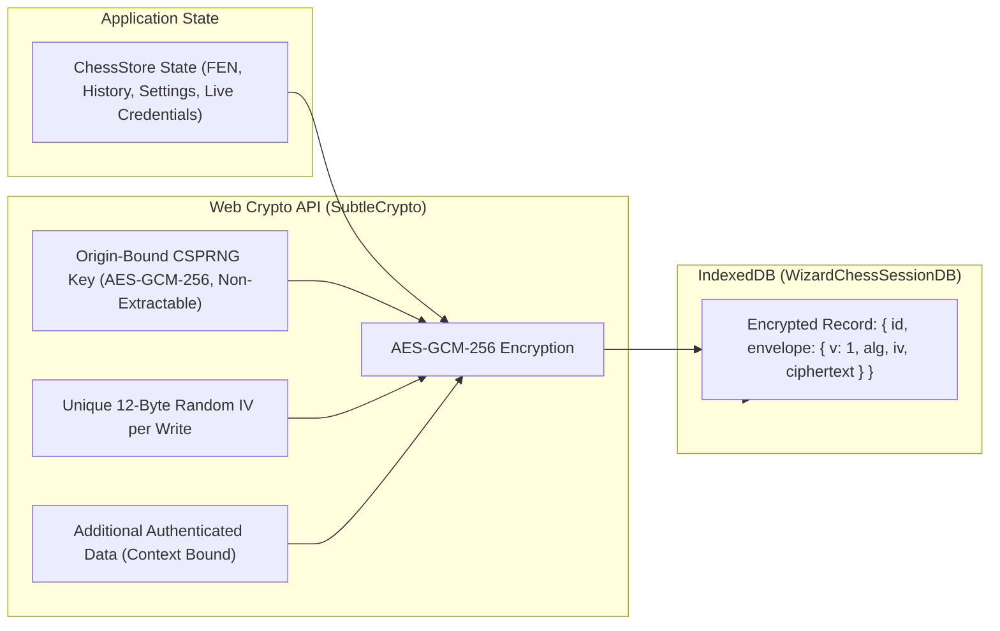

# 🛡️ Security & Encrypted Storage Guide — Wizard's Chess 3D

This guide documents the cryptographic principles, storage architecture, privacy guarantees, and repository security policies enforced in **Wizard's Chess 3D**.

---

## 🔐 Encrypted Client Storage (`IndexedDB`)

All persistent application data (board state, move history, game settings, device profile, and live multiplayer session tokens) is stored exclusively in **IndexedDB** (`WizardChessSessionDB`). 

> [!IMPORTANT]
> **Zero LocalStorage Policy**: `localStorage` and `sessionStorage` are strictly forbidden across the codebase because they store unencrypted plaintext at rest and are vulnerable to cross-site scripting (XSS) extraction.

---

## 🔑 Key Management & Cryptographic Specifications

| Parameter | Specification | Purpose |
|---|---|---|
| **Cipher Algorithm** | `AES-GCM-256` | Authenticated Encryption with Associated Data (AEAD). |
| **Key Length** | 256 bits (32 bytes) | Cryptographically secure key size. |
| **Key Generation** | `crypto.subtle.generateKey` (`extractable: false`) | Generated on the client using the browser's CSPRNG. **Non-extractable**: cannot be exported as raw bytes or read by scripts. |
| **Key Storage** | Stored once in `sanctuary_sessions` (`__origin_bound_non_extractable_key__`) | Origin-bound within the client's isolated IndexedDB database. |
| **Zero Hardcoded Keys** | 100% verified | **Zero** pre-shared or hardcoded keys exist in source code or compiled bundles. |
| **Initialization Vector (IV)** | 12 bytes (96 bits) CSPRNG per record | A fresh, cryptographically random IV is generated for every single write operation, preventing ciphertext replay or frequency analysis attacks. |
| **Authentication Tag** | 128 bits | Guarantees tamper-detection; any modified byte immediately fails authentication during decryption. |
| **AAD Context Binding** | Record identifier (e.g., `active_session`, `persistence_preference`) | Binds ciphertext to its intended record slot, preventing cross-record envelope transplant attacks. |

---

## 🔍 Encrypted Storage Audit Modal & Wipe Flow

Players can inspect their stored data at any time via the **Storage Audit Modal** (`#storage-audit-modal`):

1. **Zero Plaintext Inspection**:
   - The audit dialog displays the cryptographic parameters (`AES-GCM-256`, 256-bit key, 12-byte IV, non-extractable key status).
   - Shows the exact Base64-encoded encrypted envelopes stored at rest.
   - Proves mathematically that no plaintext FEN strings, move coordinates, or player credentials exist in storage.
2. **Two-Step "Wipe & Start Over" Flow**:
   - Features a fail-safe two-step wipe mechanism (`#btn-wipe-storage` → `#btn-confirm-wipe`).
   - Completely erases all stored session records **and destroys the encryption key**.
   - The next write generates a brand-new master key, rendering any previously written ciphertext permanently unreadable.

---

## 🚨 Universal Credential & Vulnerability Pre-Commit/Pre-Push Policy

In accordance with repository and workspace engineering rules (`AGENTS.md` Rule 8):

1. **Zero Secret Leaks**:
   - Real credentials, API keys, database tokens, or PocketHost superuser passwords must **NEVER** be committed or pushed to Git.
   - All secret variables (`PB_ADMIN_EMAIL`, `PB_ADMIN_PASSWORD`) must be injected via external environment variables sourced from `~/.zshrc`.
2. **Automated Verification**:
   - `.gitignore` strictly excludes `.env`, `.env.*` (except `.env.example`), and private key extensions (`*.key`, `*.pem`, `*.cert`).
   - Every commit and push is preceded by an automated Git log and diff scan verifying zero credentials exist in tracked files.
